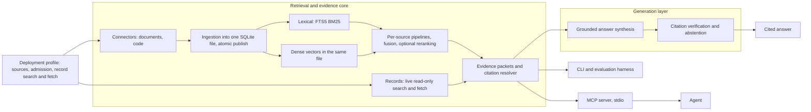

# MimiRAG

Retrieval-augmented generation with verifiable citations, over technical
documentation, source code and immutable records.

In Norse myth, Odin kept the head of Mímir, guardian of the well of wisdom,
and consulted it for knowledge and counsel. MimiRAG plays that part for
people and AI agents: it answers questions from a body of evidence, and every
claim can be traced back to its exact origin.

**Status:** pre-alpha, design stage. No code has been published yet.
Development starts with the retrieval and citation core; generation follows
(see [Roadmap](#roadmap)).

## What it is

MimiRAG is a complete RAG system built in two layers:

- **Retrieval and evidence core.** It finds relevant passages, code and
  records, and returns typed evidence packets with content-addressed
  citations that a resolver can verify against the original sources.
- **Grounded generation.** It writes answers from that evidence, with inline
  citations that must resolve, flags unsupported claims and abstains when the
  evidence is insufficient.

The two layers serve two modes of use:

- **Agent mode.** MCP-capable agents call the retrieval tools directly and
  write their own answers from the returned evidence.
- **Answer mode.** MimiRAG's own generation layer produces cited answers
  through a pluggable model backend, local or hosted.

The retrieval core stays usable on its own, with no model. It serves three
complementary kinds of knowledge:

- **Technical documentation:** PDF, HTML, Markdown and reStructuredText.
- **Source code:** files read at pinned Git commits.
- **Immutable records:** experiment logs, findings and decisions, queried live
  through a small interface supplied by each deployment.

MimiRAG is domain-agnostic. A deployment profile declares the admitted
sources and, optionally, a record store. The core assumes no domain,
repository layout or record schema.

## Design principles

- **Verifiable citations.** Locators are content-addressed: source identity
  and version (content hash or commit), extraction-output hash, page, line
  span and the hash of the cited text. A resolver checks a citation against
  the original bytes. Adding sources or rebuilding the index never
  invalidates an unchanged citation, and a changed source fails loudly.
- **Grounded answers.** Every generated claim must cite evidence that
  resolves. Unsupported claims are reported, not hidden, and insufficient
  evidence produces an abstention rather than a guess.
- **Layered.** Generation is built on the retrieval core, never inside it.
  The core has no LLM client and no retrieval-framework dependency. Model
  backends are pluggable.
- **Proportionate freshness.** Source bytes are verified at ingestion and
  again when a citation is resolved. Each query runs only cheap checks: file
  stat keys, Git commits and the profile's admission state.
- **Lightweight.** One SQLite file per index, published by atomic rename, and
  one stdio process. No server, queue or hosted database.
- **Offline by default.** Tests run with networking disabled. Nothing silently
  downloads models, tokenizers or data; any model use is explicit and
  recorded.
- **Untrusted content.** Retrieved text is evidence, never instructions. Tools
  are read-only, confine paths to allowlists, bound result sizes, use literal
  queries and never execute retrieved text.
- **Measured before claimed.** A retrieval or generation change is adopted
  only after a pre-declared, paired comparison against the current baseline.

## Architecture (planned)

| Component | Responsibility |
|---|---|
| Extraction | Reading-order PDF text with page mapping, repeated-banner removal and optional OCR for image-only pages through a configurable command; HTML, Markdown and reStructuredText by structure |
| Index | SQLite FTS5 with BM25; dense vectors in the same file, searched exactly |
| Code | Bounded reads of Git blobs at pinned commits; syntax-aware chunking |
| Records | Two profile functions, search and fetch; no generic record schema |
| Citations | Content-addressed locators and a resolver that re-verifies against the original bytes |
| Generation | Answer synthesis from evidence packets through a pluggable model backend; every citation verified by the resolver; explicit abstention |
| Agent interface | A stdio MCP server for MCP-capable agents; a CLI for scripts |
| Evaluation | Retrieval: quote-aligned, nugget-based evidence coverage, rank and context-budget metrics, MRR, paired bootstrap comparisons and run manifests. Answers: nugget recall, citation support and abstention behaviour |

## Roadmap

1. **Retrieval and citation core:** extraction, lexical index, citation
   resolver, code reader, record interface, retrieval evaluation harness and
   CLI, with tests built on fixtures written for this project.
2. **MCP server:** typed tool schemas, structured results, read-only
   behaviour and actionable errors. Agents can then use MimiRAG for RAG with
   their own models.
3. **Example benchmark:** a small, domain-agnostic corpus authored entirely
   for this project (documents, PDFs, a toy code repository and synthetic
   records) with reference cases. It demonstrates and regression-tests the
   harness; it is not a measure of quality.
4. **Hybrid retrieval:** local open-weight embedding models, fusion and
   optional reranking, each adopted only on a measured gain.
5. **Grounded generation:** answer synthesis with resolver-verified citations,
   unsupported-claim reporting and abstention, a pluggable model backend, and
   answer-level evaluation against the retrieval-only baseline.

## Content and licensing

- The source code is licensed under the [Apache License 2.0](LICENSE).
- Example corpora and benchmark content authored for this project, once
  added, will be licensed under
  [CC BY 4.0](https://creativecommons.org/licenses/by/4.0/).
- The repository contains no third-party content. Dependencies are declared,
  not vendored.

Copyright 2026 Bernardo Lino de Oliveira.
